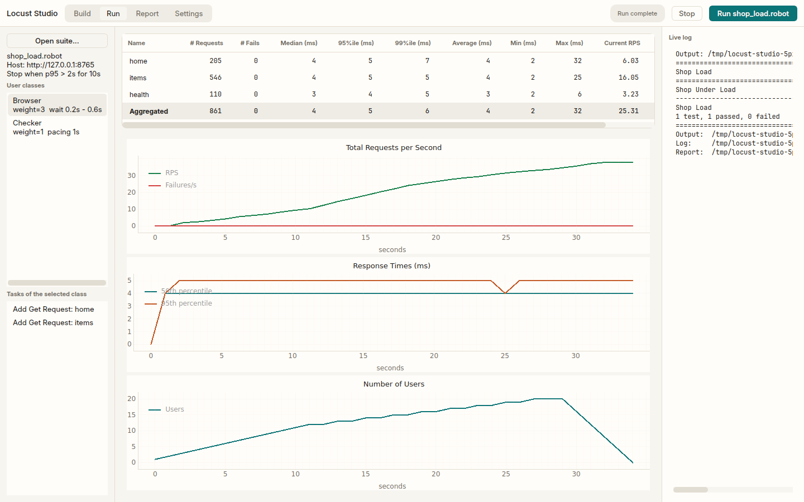
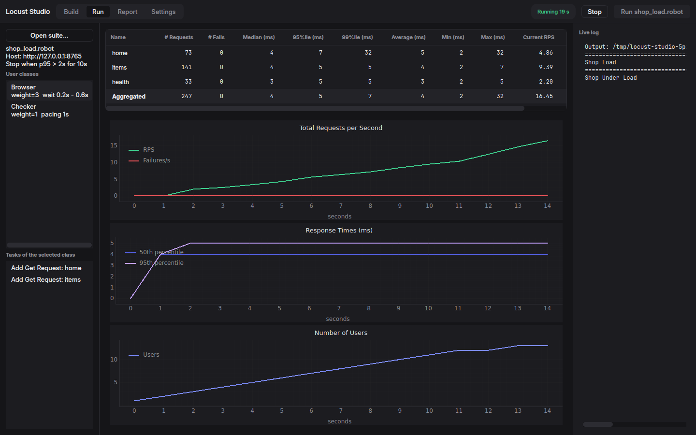

# robotframework-locust

- [Website](https://ai94iq.github.io/robotframework-locust/)
- [PyPI](https://pypi.org/project/robotframework-locust/)
- [Keyword reference](https://ai94iq.github.io/robotframework-locust/keywords.html)

A Robot Framework library that builds and runs Locust load tests. You write
the load as a Robot suite: the library creates the Locust users, runs them
headless and checks the stats with keywords. Locust Studio shows a run live,
and `rflocust-k6` turns a k6 script into a Robot project.



## Contents

- [Install](#install)
- [Write a load suite](#write-a-load-suite)
- [Watch it in Locust Studio](#watch-it-in-locust-studio)
- [Convert a k6 script](#convert-a-k6-script)
- [Safety limits](#safety-limits)
- [Documentation](#documentation)
- [For coding agents](#for-coding-agents)
- [Contributing](#contributing)
- [License](#license)

## Install

Requires Python 3.11 or newer. Robot Framework 7.5 or newer and Locust (2.30
or newer, below 3) install with the library.

```
pip install robotframework-locust
pip install "robotframework-locust[studio]"   # adds locust-studio
pip install "robotframework-locust[k6]"       # adds rflocust-k6
```

From a checkout: `uv sync`, or `pip install .`.

## Write a load suite

```robotframework
*** Settings ***
Library    LocustLibrary

*** Test Cases ***
Home Page Under Load
    Create Load Test    https://test.example.com    allowed_hosts=test.example.com
    Add Get Request    home    /    expected_status=200
    Set Load Stages    30s:10    15s:0
    Run Load Test    max_users=50
    Should Have No Failures
    Export Report    home-run
```

```
robot home_load.robot
```

The suite builds the users, runs them, then checks the numbers. The full
example, with waits, stop rules and response-time checks, is in
[docs/library.md](https://github.com/ai94iq/robotframework-locust/blob/main/docs/library.md#a-first-suite).

Run Load Test logs a stats table and sample calls. The `Authorization`,
`Proxy-Authorization`, `Cookie` and `Set-Cookie` headers show as `***`.
So do the body fields `password`, `client_secret`, `access_token`,
`refresh_token`, `id_token` and `otp`. This list is fixed. URLs, other
headers (such as `X-Api-Key`) and other fields (such as `token`) are logged
as sent.

Export Report writes two files to Robot's output folder, beside `log.html`:
`home-run_stats.csv` and the Locust HTML report `home-run.html`. The log
links the report. With no name, the files are `locust_stats.csv` and
`locust.html`.

The library has keywords for user classes, pacing, stop rules, Python tasks,
per-user numbers, data handed between users, and checks for response time,
error rate and throughput. See [docs/library.md](https://github.com/ai94iq/robotframework-locust/blob/main/docs/library.md).

## Watch it in Locust Studio

```
locust-studio
```

Open a suite (Ctrl+O) and press Run (Ctrl+R). Studio runs the suite under
Robot and updates the stats table and Studio's three charts every second.
When the run ends, the Report tab shows the final stats. Open Robot log is
enabled when the run wrote `log.html`. Open Locust report is enabled when the
suite called Export Report.
Stop ends a run. A run started from the Build tab then shows "Run stopped". A
suite run shows "Run ended, Robot exit code N", as for any non-zero exit.
Studio has a dark and a light theme and runs on Windows and Linux. See
[docs/studio.md](https://github.com/ai94iq/robotframework-locust/blob/main/docs/studio.md).



## Convert a k6 script

```
rflocust-k6 checkout.js --out robot --trust-script
robot -v ENV:dev robot/tests
```

The converter reads the script's options with `k6 inspect` and scans its
functions for plain HTTP calls. Stages, thresholds and simple requests become
keywords. A function it cannot read becomes a Python task stub. Until you
port it, the stub records a failed HAND PORT request and stops its user. A
report gives each item a status, such as mapped, approximate or hand port.
The full list is in the mapping table of docs/k6-converter.md. The k6 binary must be on PATH.
`k6 inspect` runs the script's top-level (init) code as your user, so the
converter runs it only with `--trust-script` (see
[docs/k6-converter.md](https://github.com/ai94iq/robotframework-locust/blob/main/docs/k6-converter.md)). Without that flag it exits 1 and says why. Convert only
scripts you trust. The host is the origin the script calls most; `--host`
sets it instead. An existing tasks file (`combined_tasks.py` for
`combined.js`) is kept; `--force` rewrites it. The suites it writes set these limits by default:

- `allowed_hosts`;
- the stop rule `fail > 10% for 30s`;
- the stop rule `idle > 30s`;
- `stop_on_fail_ratio=20%` on Run Load Test.

See [docs/k6-converter.md](https://github.com/ai94iq/robotframework-locust/blob/main/docs/k6-converter.md).

## Safety limits

A load test can take a server down. This page lists the limits in short;
[docs/safety.md](https://github.com/ai94iq/robotframework-locust/blob/main/docs/safety.md) holds the full rules. These protections are always on:

- Run Load Test refuses a run above `max_users` (default 100).
- The Locust web UI and distributed mode bind 127.0.0.1 only.

Run Distributed checks `max_users` only when you pass `users` (default 0, no
check). Start Locust Web takes no user count, so it has no ceiling.

These limits work only when you set them:

- Create Load Test refuses a host that is not on `allowed_hosts` or
  `LOCUSTLIBRARY_ALLOWED_HOSTS`. With neither set, any host is accepted and
  one warning is logged. Start Locust Web and Run Distributed check an
  optional `host` the same way. Suites made by the k6 converter set the list.
- `Add Stop Rule    p95 > 1s for 10s` and `stop_on_fail_ratio` (default 0,
  off) stop a run early. `Add Stop Rule    idle > 30s` stops a run when no
  response came back for 30s. By default a stop rule fails the run; end the
  rule with `, stop as passed` to only stop. A `stop_on_fail_ratio` stop also
  fails the run; set `breaker_fails=False` to let it pass.
- `fail_on_busy_cpu=True` fails the run when the load generator's CPU went
  over 90%.
- `shared_limit` (library import, default 10000, 0 for no limit) caps the
  values kept per shared name. Putting more fails.
- With `expected_text` set, a response whose body lacks that text fails.

Start Locust Web and Run Distributed run your own locustfile as it is: stop
rules do not apply to them.

Read [docs/safety.md](https://github.com/ai94iq/robotframework-locust/blob/main/docs/safety.md) before you point a run at a host you do
not own.

## Documentation

| Page | What it covers |
|---|---|
| [docs/library.md](https://github.com/ai94iq/robotframework-locust/blob/main/docs/library.md) | Writing suites, every keyword, Python tasks, reports |
| [docs/safety.md](https://github.com/ai94iq/robotframework-locust/blob/main/docs/safety.md) | Every limit and how to set it |
| [docs/studio.md](https://github.com/ai94iq/robotframework-locust/blob/main/docs/studio.md) | Locust Studio |
| [docs/k6-converter.md](https://github.com/ai94iq/robotframework-locust/blob/main/docs/k6-converter.md) | The k6 mapping, its limits, porting by hand |
| [docs/cli.md](https://github.com/ai94iq/robotframework-locust/blob/main/docs/cli.md) | The commands and their options |
| [docs/keywords.html](https://ai94iq.github.io/robotframework-locust/keywords.html) | Keyword reference, built by libdoc |
| [docs/references.md](https://github.com/ai94iq/robotframework-locust/blob/main/docs/references.md) | Sources: Locust, Robot Framework, Taurus, rfswarm, packaging, gevent, PySide, security, arXiv papers and other research |
| [CHANGELOG.md](https://github.com/ai94iq/robotframework-locust/blob/main/CHANGELOG.md) | Changes per release |

## For coding agents

`.skills/using-locust-library/SKILL.md` tells a coding agent how to write,
run and check a load suite with this library, with the safety limits first.
Copy the folder into your agent's skills folder to use it in another repo.

## Contributing

See [CONTRIBUTING.md](https://github.com/ai94iq/robotframework-locust/blob/main/CONTRIBUTING.md) for the setup, the checks and the rules
a change must keep.

## License

MIT. See [LICENSE](https://github.com/ai94iq/robotframework-locust/blob/main/LICENSE).
