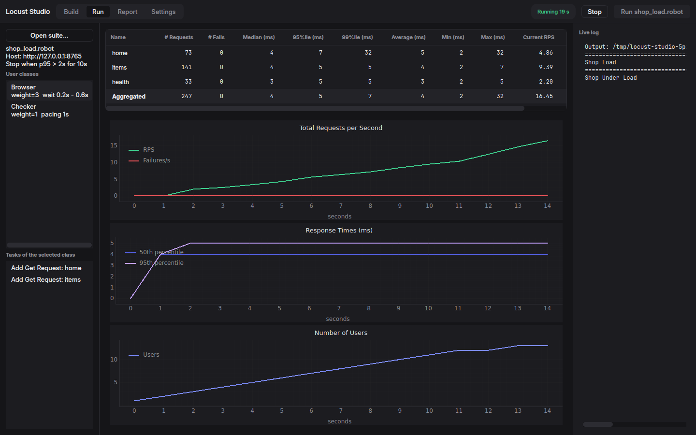
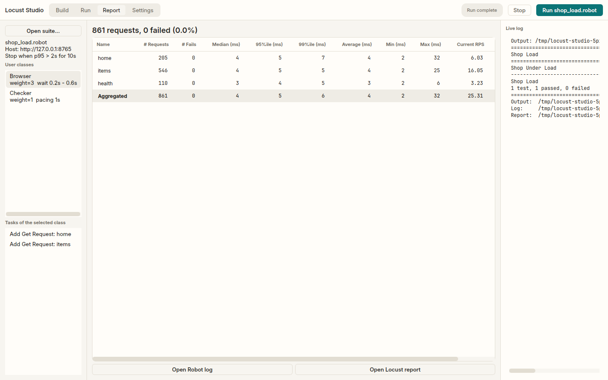

# Locust Studio

A desktop window that opens a load suite, runs it under Robot and shows the
run live. It ships as the `studio` extra:

```
pip install "robotframework-locust[studio]"
locust-studio
```

Studio needs PySide6 and pyqtgraph, which the extra installs. It runs on
Windows and Linux.


## Contents

- [Open a suite](#open-a-suite)
- [Run it](#run-it)
- [The report](#the-report)
- [Build tab](#build-tab)
- [Settings](#settings)
- [Keys](#keys)

## Open a suite

**Open suite...** (Ctrl+O) reads a `.robot` load suite with a Robot dry
run, so no request is sent. The dry run still imports the suite's Python
libraries and variable files, so open only suites you trust. The sidebar shows the suite's host and stop rules,
then each user class with its weight, wait time or pacing. Pick a class to see
its tasks. A host that comes from a variable, such as `${HOST}`, shows its
value when the variable is in scope.

## Run it

**Run** (Ctrl+R) starts Robot on the suite at low priority, into a temporary
output folder. Robot's console output goes to the live log on the right.
Every second the stats table and three charts update: requests and failures
per second, the 50th and 95th percentile response times, and users.



**Stop** ends the Robot process of a suite run. A Build tab run (see
[Build tab](#build-tab)) cannot be stopped from Studio: Stop stays
disabled and the run lasts for its run time.

Run Load Test writes the live feed only when the `LOCUSTLIBRARY_FEED`
environment variable names a file. Studio sets it for its own runs, so a
suite needs no change to show in Studio.

## The report

When the run ends, the Report tab shows the request count, the failures and
Locust's statistics table. **Open Robot log** opens `log.html`. **Open
Locust report** opens the HTML report that Export Report wrote.



## Build tab

With no suite open, Run runs the HTTP tasks put together on the Build tab,
with the users, spawn rate and run time set on the Run tab.

1. On the Build tab, set **Host** (default `http://127.0.0.1:8765`),
   **Wait min** and **Wait max** (defaults `0.1s` and `0.5s`).
2. For each task, enter a name, pick GET or POST, enter a path and a weight,
   then select **Add task**.
3. On the Run tab, set **Users**, **Spawn rate** and **Run time**
   (defaults 10, 2 and `10s`), then select **Run**.

Studio runs these tasks in its own process through the same keywords a suite
uses: Create Load Test, Set Wait Time, Add GET Request or Add POST Request,
and Run Load Test. So the same host checks apply: the host must be valid, and
when `LOCUSTLIBRARY_ALLOWED_HOSTS` is set, it must be in that list. Run Load
Test uses its default `max_users` of 100. A Build tab run has no stop rules
and no Should checks. Stop stays disabled during it, so it always runs for
the full run time; keep the run time short.

## Settings

Studio has two themes: Graphite (dark, the default) and Paper (light).
[DESIGN.md](../DESIGN.md) describes both. Settings also has a right-to-left
layout switch. Studio ships the Inter and JetBrains Mono fonts under the SIL
Open Font License 1.1 (`studio/fonts/`); without them it falls back to
Segoe UI and Consolas.

## Keys

| Key | Action |
|---|---|
| Ctrl+O | Open a suite |
| Ctrl+R | Run |
| Ctrl+, | Settings |
