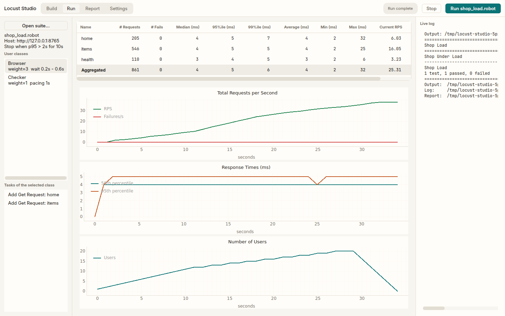
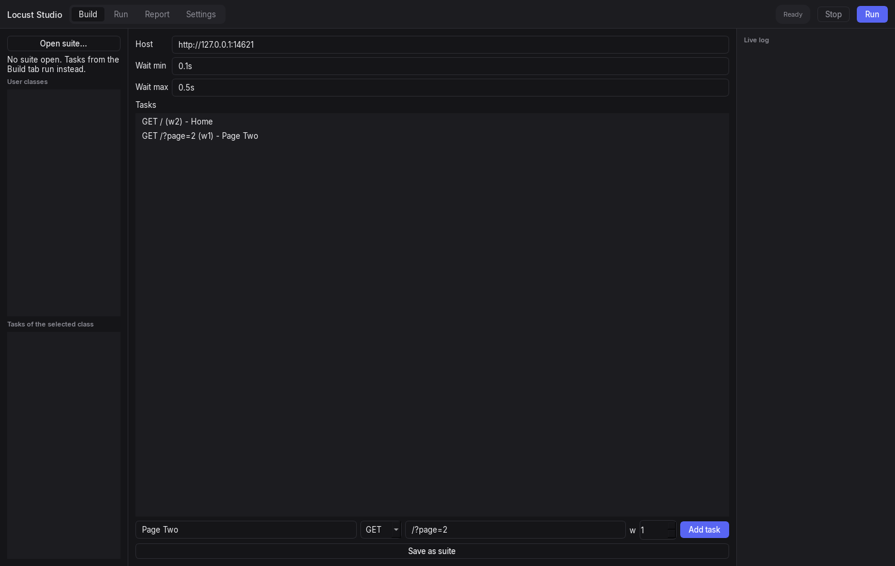

# Locust Studio

A desktop window that opens a load suite, runs it under Robot and shows the
run live. It ships as the `studio` extra:

```
pip install "robotframework-locust[studio]"
locust-studio
```

Studio needs PySide6 and pyqtgraph, which the extra installs. It runs on
Windows and Linux. It is not tested on macOS.



## Contents

- [Open a suite](#open-a-suite)
- [Run it](#run-it)
- [The report](#the-report)
- [Build tab](#build-tab)
- [Settings](#settings)
- [Keys](#keys)

## Open a suite

**Open suite...** (Ctrl+O) reads a `.robot` load suite and its resource
files without running them. No request is sent, and no Python library or
variable file is imported.

The sidebar shows the suite's host and stop rules, then each user class
with its weight, wait time or pacing. Pick a class to see its tasks. A host
that comes from a variable, such as `${HOST}`, shows its value when the
variable is set in a `*** Variables ***` section of the suite or one of its
resource files. Values from variable files or the command line are not read.
A variable that a user keyword gets through `[Arguments]` shows the value
passed to it. When you open a folder, each child suite is read with its own
variables and keywords.
When the variable is not found, the sidebar shows the
variable as written, such as `${HOST}`.

## Run it

**Run** (Ctrl+R) starts Robot on the suite at low priority. Robot writes its
output to a new folder in the system temp folder, named `locust-studio-`
and a random suffix. The live log shows the folder path when the run starts.
Studio does not delete the folder, so the Report buttons work while it
exists. Old `locust-studio-*` folders stay in the system temp folder (`%TEMP%`
on Windows, usually `/tmp` on Linux) until you delete them. Robot's console output goes to the live log on the right.
Every second the stats table and three charts update: requests and failures
per second, the 50th and 95th percentile response times, and users.


**Stop** ends the Robot process of a suite run. The live log shows
"Stopped." and the status shows "Run ended, Robot exit code N", with the
exit code Robot returned.

Run Load Test writes the live feed only when the `LOCUSTLIBRARY_FEED`
environment variable names a file. Studio sets it for its own runs, so a
suite needs no change to show in Studio.

## The report

When the run ends, the Report tab shows the request count, the failures and
Locust's statistics table. **Open Robot log** opens `log.html`. **Open
Locust report** opens the HTML report that Export Report wrote. If the
suite did not call Export Report, this button stays disabled. If the run
wrote no `log.html`, **Open Robot log** stays disabled.


## Build tab



With no suite open, Run turns the HTTP tasks put together on the Build tab
into a Robot suite and runs that suite like an opened one, with the users,
spawn rate and run time set on the Run tab. Studio has no
action that closes a suite. So the Build tab runs only before the first
suite is opened. To use it after that, start Studio again.

1. On the Build tab, set **Host** (default `http://127.0.0.1:8765`),
   **Wait min** and **Wait max** (defaults `0.1s` and `0.5s`).
2. For each task, enter a name, pick GET or POST, enter a path and a weight,
   then select **Add task**. A POST task sends no body. A task passes when
   the response status is 200. The Build tab has no fields for headers, a
   body or the expected status.
3. On the Run tab, set **Users**, **Spawn rate** and **Run time**
   (defaults 10, 2 and `10s`), then select **Run**.

The suite calls Create Load Test, Set Wait Time, Add Get Request or Add
Post Request for each task, two stop rules (`fail > 10% for 30s` and
`idle > 30s`), Run Load Test with `stop_on_fail_ratio=20%`, and Export
Report. So a Build tab run gets the same host checks, stop rules, Stop
button, Robot log and Locust report as an opened suite. Run Load Test uses
its default `max_users` of 100. Studio writes the suite to a new
`locust-studio-suite-*` folder in the system temp folder and does not
delete it.

A name, path, host, wait time or run time must be one Robot value: no
empty value, no spaces at either end, no double spaces, tabs or line
breaks. Studio shows a warning and does not run otherwise.

**Save as suite** writes the same suite to a `.robot` file you pick, with
the Run tab's users, spawn rate and run time. Open that file in any editor
to add headers, bodies, user classes, pacing or Should checks, then open it
in Studio with **Open suite**.

## Settings

Studio has two themes: Graphite (dark, the default) and Paper (light).
Settings also has a right-to-left layout switch. [DESIGN.md](../DESIGN.md)
describes the themes and the fonts, which ship in
`src/LocustLibrary/studio/fonts/`.

## Keys

| Key | Action |
|---|---|
| Ctrl+O | Open a suite |
| Ctrl+R | Run |
| Ctrl+, | Settings |
